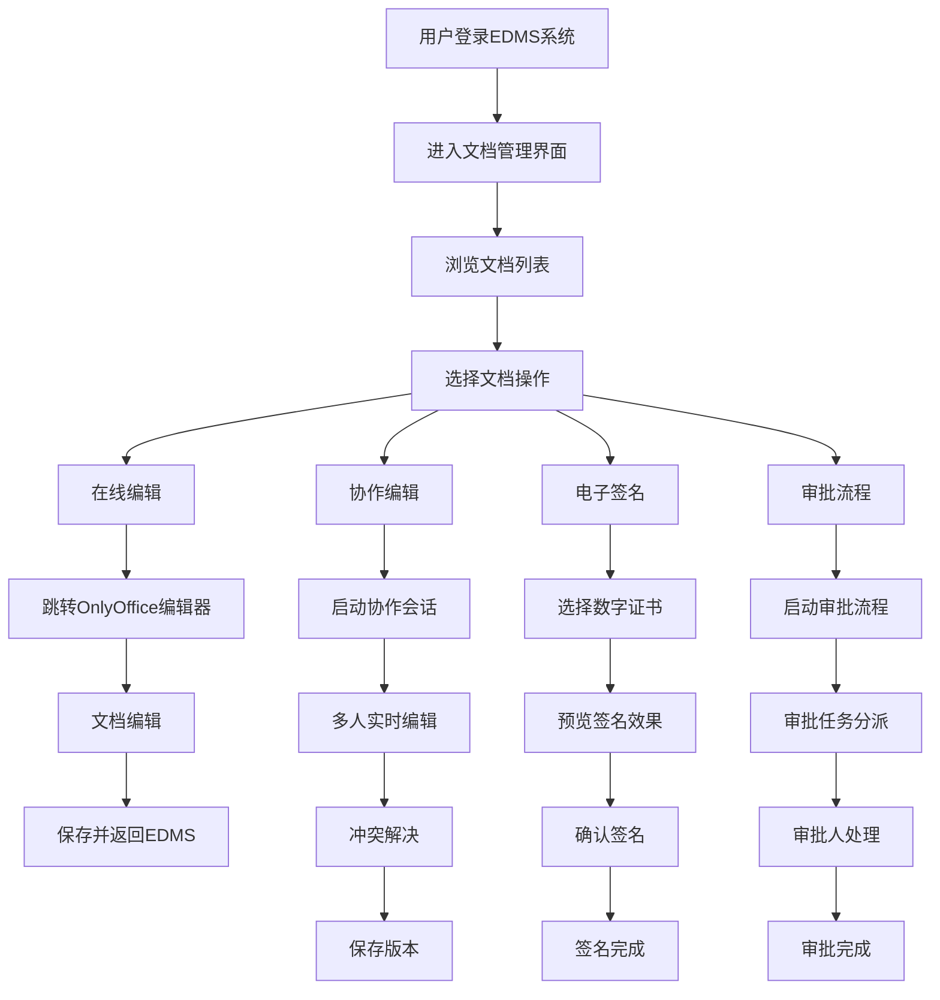
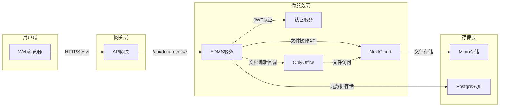
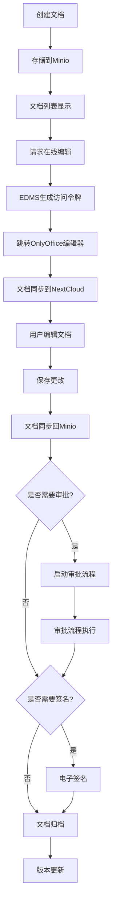
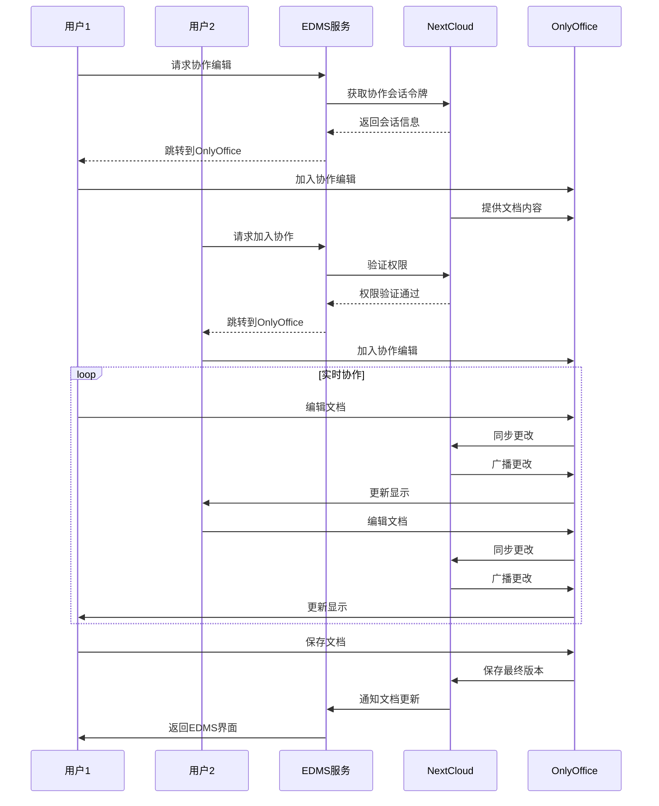
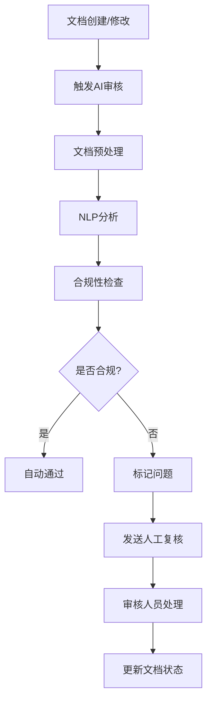

# EDMS子系统集成NextCloud和OnlyOffice设计方案

## 1. 概述

本方案旨在为GMP系统的EDMS (Electronic Document Management System) 子系统集成NextCloud和OnlyOffice，以提供在线文档编辑、创建、电子签名和审批流程功能。通过该集成，用户将能够在浏览器中直接创建和编辑文档，并利用专业的审批流程和电子签名功能来满足GMP合规要求。

## 2. 当前系统分析

根据[ARCHITECTURE.md](file:///home/liying/gmp-system/services/edms-service/ARCHITECTURE.md)文档，当前EDMS服务具有以下特点：

- 使用Minio作为文件存储后端
- 提供RESTful API接口
- 支持文档版本控制
- 具备基本的文档分类和元数据管理功能
- 实现了与原有File服务的整合

然而，当前系统缺乏：
- 在线文档编辑功能
- 协作编辑能力
- 专业的电子签名功能
- 高级审批流程

## 3. 集成目标

### 3.1 核心功能目标

1. **在线文档编辑**：支持用户在浏览器中直接创建和编辑文档
2. **协作编辑**：支持多用户同时编辑同一文档
3. **电子签名**：实现符合GMP要求的电子签名功能
4. **审批流程**：构建可配置的文档审批流程

### 3.2 技术目标

1. 集成NextCloud作为文档协作平台
2. 集成OnlyOffice作为文档编辑器
3. 保持与现有Minio存储的兼容性
4. 扩展现有的RESTful API以支持新功能

## 4. 技术方案

### 4.1 架构设计

```
+------------------+     +------------------+     +------------------+
|                  |     |                  |     |                  |
|  Web客户端       +---->+  EDMS 控制器层   +---->+  NextCloud API   |
|                  |     |                  |     |                  |
+------------------+     +------------------+     +------------------+
                                |                          |
                                v                          v
+------------------+     +------------------+     +------------------+
|                  |     |                  |     |                  |
|  OnlyOffice      +<----+  EDMS 服务层     +---->+  NextCloud存储   |
|  文档编辑器      |     |                  |     |                  |
+------------------+     +------------------+     +------------------+
                                |
                                v
+------------------+     +------------------+
|                  |     |                  |
|  Minio对象存储   +<----+  存储适配器      |
|                  |     |                  |
+------------------+     +------------------+
```

### 4.2 组件说明

#### 4.2.1 NextCloud集成

NextCloud将作为文档协作平台，提供以下功能：
- 用户管理与认证
- 文件存储与版本控制
- 协作与分享功能
- 审批流程基础框架

#### 4.2.2 OnlyOffice集成

OnlyOffice将作为文档编辑器，提供以下功能：
- 在线文档编辑（Word、Excel、PowerPoint等格式）
- 实时协作编辑
- 文档格式转换
- 评论与修订跟踪

#### 4.2.3 EDMS服务扩展

EDMS服务将扩展以下功能：
- 与NextCloud的API集成
- 电子签名服务
- 审批流程管理
- 与现有Minio存储的桥接

### 4.3 集成方式

#### 4.3.1 认证集成

1. EDMS服务将作为认证中介，处理用户凭证并转发到NextCloud
2. 使用JWT令牌确保安全通信
3. 保持与现有GMP系统统一认证机制的一致性

#### 4.3.2 存储集成

1. 保持现有的Minio存储作为主存储
2. NextCloud作为协作编辑的临时存储
3. 实现两个存储系统之间的同步机制

#### 4.3.3 文档生命周期管理

1. 文档创建：用户通过EDMS创建文档，存储在Minio中
2. 文档编辑：文档同步到NextCloud，用户使用OnlyOffice进行编辑
3. 版本控制：编辑完成后，新版本同步回Minio
4. 审批流程：在EDMS中触发和管理审批流程
5. 电子签名：在审批完成后应用电子签名

## 5. 功能详细设计

### 5.1 在线文档编辑

#### 5.1.1 功能描述

用户可以直接在浏览器中创建和编辑文档，支持常见的Office文档格式。

#### 5.1.2 技术实现

1. 用户请求编辑文档时，EDMS服务生成临时访问令牌
2. 前端重定向到OnlyOffice编辑器
3. OnlyOffice通过NextCloud访问和编辑文档
4. 编辑完成后，通过回调通知EDMS服务

### 5.2 协作编辑

#### 5.2.1 功能描述

支持多个用户同时编辑同一文档，实现实时协作。

#### 5.2.2 技术实现

1. NextCloud提供实时协作功能
2. OnlyOffice编辑器支持多人同时编辑
3. 通过WebSocket实现实时通信
4. 冲突解决机制确保数据一致性

### 5.3 电子签名

#### 5.3.1 功能描述

实现符合GMP要求的电子签名功能，确保文档的完整性和不可否认性。

#### 5.3.2 技术实现

1. 基于数字证书的电子签名机制
2. 与认证服务集成，验证用户身份
3. 签名信息存储在数据库中，包括签名时间、签名者信息等
4. 签名验证功能确保文档未被篡改

### 5.4 审批流程

#### 5.4.1 功能描述

构建可配置的文档审批流程，支持多级审批和并行审批。

#### 5.4.2 技术实现

1. 基于工作流引擎实现审批流程
2. 支持串行和并行审批
3. 审批状态跟踪和历史记录
4. 审批通知机制（邮件、站内信等）

## 6. 数据模型扩展

### 6.1 电子签名表 (electronic_signatures)

| 字段名 | 类型 | 描述 |
|--------|------|------|
| id | BIGINT | 主键 |
| document_id | BIGINT | 关联文档ID |
| signer_id | VARCHAR | 签名人ID |
| signature_data | TEXT | 签名数据 |
| signed_at | TIMESTAMP | 签名时间 |
| certificate_info | TEXT | 证书信息 |

### 6.2 审批流程表 (approval_workflows)

| 字段名 | 类型 | 描述 |
|--------|------|------|
| id | BIGINT | 主键 |
| document_id | BIGINT | 关联文档ID |
| workflow_definition | TEXT | 流程定义 |
| current_step | INT | 当前步骤 |
| status | VARCHAR | 流程状态 |
| created_at | TIMESTAMP | 创建时间 |

### 6.3 审批步骤表 (approval_steps)

| 字段名 | 类型 | 描述 |
|--------|------|------|
| id | BIGINT | 主键 |
| workflow_id | BIGINT | 关联流程ID |
| step_number | INT | 步骤序号 |
| approver_id | VARCHAR | 审批人ID |
| status | VARCHAR | 步骤状态 |
| comments | TEXT | 审批意见 |
| approved_at | TIMESTAMP | 审批时间 |

## 7. API接口设计

### 7.1 文档编辑接口

```
POST /api/documents/{documentId}/edit
功能：获取文档编辑权限和链接
参数：
- documentId: 文档ID
返回：
- editUrl: OnlyOffice编辑器链接
- token: 访问令牌
```

### 7.2 电子签名接口

```
POST /api/documents/{documentId}/sign
功能：对文档进行电子签名
参数：
- documentId: 文档ID
- certificate: 数字证书
返回：
- signatureId: 签名ID
- success: 是否成功
```

### 7.3 审批流程接口

```
POST /api/documents/{documentId}/approve
功能：启动文档审批流程
参数：
- documentId: 文档ID
- workflowDefinition: 流程定义
返回：
- workflowId: 流程ID
- success: 是否成功

PUT /api/approvals/{workflowId}/steps/{stepId}
功能：执行审批步骤
参数：
- workflowId: 流程ID
- stepId: 步骤ID
- action: 审批动作（同意/拒绝）
- comments: 审批意见
返回：
- success: 是否成功
- nextStep: 下一步信息
```

## 8. 安全与合规

### 8.1 数据安全

1. 所有传输数据使用HTTPS加密
2. 敏感数据（如签名私钥）加密存储
3. 访问令牌有时效性限制

### 8.2 GMP合规

1. 完整的审计追踪记录
2. 电子签名符合21 CFR Part 11要求
3. 文档版本控制确保数据完整性

## 9. 部署架构

### 9.1 组件部署

1. **NextCloud服务器**：独立部署，用于文档协作
2. **OnlyOffice服务器**：独立部署，提供文档编辑服务
3. **EDMS服务**：现有微服务扩展

### 9.2 网络架构

```
用户浏览器 --> API网关 --> EDMS服务 <--> NextCloud <--> OnlyOffice
                              |
                              v
                           Minio存储
```

## 10. 实施计划

### 10.1 第一阶段：基础集成

1. 部署NextCloud和OnlyOffice服务
2. 实现EDMS与NextCloud的基础集成
3. 实现文档在线编辑功能

### 10.2 第二阶段：高级功能

1. 实现协作编辑功能
2. 开发电子签名功能
3. 实现审批流程引擎

### 10.3 第三阶段：优化完善

1. 性能优化
2. 安全加固
3. 用户体验改进

## 11. 风险评估与应对

### 11.1 技术风险

1. **集成复杂性**：NextCloud和OnlyOffice集成可能遇到兼容性问题
   - 应对：充分的技术调研和原型验证

2. **性能问题**：大量用户同时在线编辑可能导致性能瓶颈
   - 应对：合理的架构设计和性能测试

### 11.2 安全风险

1. **数据泄露**：文档在传输和存储过程中可能被非法访问
   - 应对：加强加密措施和访问控制

2. **签名伪造**：电子签名可能被伪造或篡改
   - 应对：采用标准的数字签名技术和严格的证书管理

## 12. 总结

通过集成NextCloud和OnlyOffice，EDMS子系统将获得强大的在线文档编辑和协作能力，同时满足GMP对电子签名和审批流程的要求。该方案充分利用了现有系统的架构优势，并通过扩展实现了所需的新功能，为用户提供更加完善的文档管理解决方案。

## 13. 界面设计

### 13.1 整体界面架构

为了实现NextCloud和OnlyOffice与现有EDMS系统的无缝集成，我们需要设计一套统一的用户界面架构，让用户能够在同一个界面环境中完成所有文档相关的操作。

#### 13.1.1 主界面布局

主界面将采用经典的三栏布局设计，符合[项目规范](#)中提到的界面集成规范：
- **左侧导航栏**：显示文档分类、快速访问链接和系统功能菜单
- **中间内容区**：显示文档列表、详细信息和操作面板
- **右侧信息栏**：显示文档属性、版本历史和相关操作按钮

#### 13.1.2 文档操作入口

在文档列表和详情页面中，我们将添加以下操作按钮：
- **在线编辑**：点击后跳转到OnlyOffice编辑器进行文档编辑
- **协作编辑**：启动协作编辑会话，允许多用户同时编辑
- **电子签名**：对已审批的文档进行电子签名操作
- **审批流程**：启动或查看文档的审批流程状态

### 13.2 NextCloud界面集成

#### 13.2.1 认证集成

为了提供无缝的用户体验，我们将实现单点登录(SSO)机制：
1. 用户在EDMS系统中登录后，系统会自动获取访问NextCloud的临时令牌
2. 当用户访问NextCloud功能时，系统后台自动完成认证，无需用户重新输入密码
3. 所有认证信息通过加密通道传输，确保安全性

#### 13.2.2 文件管理界面

在EDMS系统的文档管理界面中，我们将嵌入NextCloud的文件管理功能：
1. 通过iframe或API方式展示NextCloud的文件列表
2. 保持与EDMS系统一致的视觉风格和交互方式
3. 提供文件上传、下载、共享等基本功能
4. 支持文档版本管理和协作历史查看

### 13.3 OnlyOffice界面集成

#### 13.3.1 编辑器嵌入方式

我们将采用以下方式将OnlyOffice编辑器集成到系统中，满足[项目规范](#)中提到的多种打开模式要求：
1. **弹出窗口模式**：点击"在线编辑"按钮后，在新窗口或模态框中打开OnlyOffice编辑器
2. **全屏模式**：提供全屏编辑选项，让用户专注于文档编辑工作
3. **标签页模式**：在EDMS系统内部以标签页形式打开编辑器

#### 13.3.2 编辑器定制

为了更好地适应GMP环境的需求，我们将对OnlyOffice编辑器进行以下定制：
1. **功能限制**：根据用户权限限制某些敏感功能的使用
2. **样式定制**：调整编辑器的主题颜色以匹配EDMS系统的整体风格
3. **插件集成**：集成电子签名和审批流程相关插件
4. **快捷操作**：添加快速保存、版本对比等快捷操作按钮

### 13.4 协作编辑界面

#### 13.4.1 用户状态显示

在协作编辑过程中，系统将实时显示以下信息：
1. **在线用户列表**：显示当前正在编辑文档的用户
2. **光标位置**：显示其他用户的光标位置和编辑区域
3. **用户颜色标识**：为每个用户分配唯一颜色，便于区分不同用户的修改

#### 13.4.2 实时通讯功能

集成实时通讯功能，方便协作者之间交流：
1. **聊天窗口**：在编辑器侧边栏提供聊天功能
2. **评论系统**：支持对文档特定内容添加评论
3. **通知提醒**：当有新消息或重要事件时及时提醒用户

### 13.5 电子签名界面

#### 13.5.1 签名操作界面

设计简洁直观的电子签名操作界面：
1. **签名面板**：显示待签名文档的摘要信息
2. **证书选择**：允许用户选择合适的数字证书
3. **签名预览**：预览签名效果和位置
4. **确认按钮**：完成签名操作并保存

#### 13.5.2 签名验证界面

提供签名验证功能界面：
1. **签名信息展示**：显示文档的所有签名记录
2. **证书详情**：查看签名证书的详细信息
3. **验证结果**：显示签名验证的结果和状态

### 13.6 审批流程界面

#### 13.6.1 流程设计器

为管理员提供可视化的审批流程设计界面：
1. **拖拽式设计**：通过拖拽节点的方式设计审批流程
2. **节点配置**：配置每个审批节点的属性和条件
3. **流程预览**：实时预览流程执行路径
4. **版本管理**：管理不同版本的流程定义

#### 13.6.2 流程执行界面

为普通用户提供直观的流程执行界面：
1. **流程状态图**：以图形化方式显示当前流程所处的位置
2. **操作面板**：根据用户角色显示相应的操作按钮
3. **历史记录**：查看流程的历史执行记录和审批意见
4. **通知中心**：接收流程相关的通知和提醒

### 13.7 响应式设计

考虑到用户可能使用不同的设备访问系统，我们将实现响应式设计：
1. **桌面端优化**：充分利用大屏幕空间，提供丰富的功能展示
2. **平板适配**：针对触控操作进行优化，提供更大的点击区域
3. **移动端支持**：简化界面元素，突出核心功能，确保基本操作可用

### 13.8 用户体验优化

#### 13.8.1 加载性能优化

1. **懒加载**：对于复杂的界面组件，采用懒加载技术减少初始加载时间
2. **缓存机制**：合理利用浏览器缓存和服务器缓存提高响应速度
3. **资源压缩**：对CSS、JavaScript等静态资源进行压缩和合并

#### 13.8.2 交互反馈优化

1. **操作提示**：对用户的重要操作提供明确的反馈信息
2. **进度指示**：对于耗时操作显示进度条或加载动画
3. **错误处理**：友好的错误提示和恢复建议

## 14. 界面流程图

### 14.1 用户操作主流程



此流程图展示了用户在EDMS系统中的典型操作路径。用户首先登录系统并进入文档管理界面，然后可以浏览文档列表并选择相应的操作。每种操作都会引导用户进入不同的功能模块，完成相应任务后返回主界面。

### 14.2 系统集成架构图



该架构图清晰地展示了系统各组件之间的关系。用户通过Web浏览器访问系统，请求首先经过API网关路由到相应的服务。EDMS服务作为核心组件，与认证服务、NextCloud和OnlyOffice进行交互，并使用Minio存储文件和PostgreSQL存储元数据。

### 14.3 文档生命周期流程图



文档生命周期流程图描绘了一个文档从创建到最终归档的完整过程。文档首先被创建并存储在Minio中，然后可以通过在线编辑功能进行修改。编辑完成后，系统会根据配置决定是否需要进行审批和签名操作，最后文档被归档并更新版本信息。

### 14.4 协作编辑流程图



协作编辑序列图详细描述了多用户协作编辑时的交互过程。第一个用户发起协作编辑请求，EDMS服务与NextCloud交互获取会话令牌并将用户重定向到OnlyOffice编辑器。第二个用户也可以加入协作编辑会话，多个用户可以同时编辑文档并通过NextCloud实现实时同步。编辑完成后，文档会被保存并通知EDMS服务更新。

## 15. 详细说明

### 15.1 前端技术实现

前端将基于Vue.js 3和Element Plus UI组件库构建，遵循项目的[技术选型](#)要求。主要技术栈包括：

1. **Vue.js 3 + TypeScript**：用于构建用户界面，提供响应式数据绑定和组件化开发
2. **Element Plus**：提供丰富的UI组件，确保界面美观且功能完善
3. **Axios**：处理HTTP请求，与后端API进行通信
4. **WebSocket**：实现实时协作编辑功能

### 15.2 认证与授权机制

系统将实现多层次的安全机制以满足GMP合规要求：

1. **单点登录(SSO)**：用户只需在EDMS系统登录一次即可访问所有集成服务
2. **JWT令牌**：使用JSON Web Token确保服务间安全通信
3. **RBAC权限模型**：基于角色的访问控制，确保用户只能访问授权资源
4. **审计日志**：记录所有关键操作，满足审计追踪要求

### 15.3 数据同步策略

为确保数据一致性，系统将采用以下同步策略：

1. **主存储**：Minio作为主存储，确保数据持久性和可靠性
2. **临时存储**：NextCloud作为协作编辑期间的临时存储
3. **增量同步**：只同步发生变化的数据，提高同步效率
4. **冲突解决**：实现自动冲突检测和解决机制

### 15.4 性能优化措施

为提供流畅的用户体验，系统将采取以下性能优化措施：

1. **缓存机制**：使用Redis缓存频繁访问的数据
2. **懒加载**：延迟加载非关键资源，加快页面初始渲染速度
3. **CDN加速**：使用内容分发网络加速静态资源加载
4. **数据库优化**：合理设计索引和查询语句，提高数据库访问效率

### 15.5 容错与恢复机制

系统将具备完善的容错与恢复机制：

1. **故障转移**：当某个服务不可用时，自动切换到备用服务
2. **数据备份**：定期备份关键数据，防止数据丢失
3. **自动恢复**：服务重启后自动恢复到之前的状态
4. **监控告警**：实时监控系统状态，及时发现并处理异常

## 16. AI合规性审核

### 16.1 概述

在现代制药行业中，确保文档符合GMP和其他监管要求至关重要。人工审核不仅耗时耗力，而且容易出错。通过在EDMS系统中引入AI技术，我们可以自动化部分合规性审核流程，提高审核效率和准确性。

### 16.2 AI合规性审核功能设计

#### 16.2.1 文档内容合规性检查

AI系统可以自动检查文档内容是否符合GMP要求：
1. **术语标准化检查**：确保使用正确的GMP术语和行业标准表述
2. **格式规范检查**：检查文档结构、标题层级、编号系统等是否符合规范
3. **内容完整性检查**：验证文档是否包含了必要的章节和信息
4. **法规条款引用检查**：确保引用的法规条款准确且最新

#### 16.2.2 语言质量审核

AI可以协助提升文档的语言质量：
1. **语法和拼写检查**：自动检测和纠正语法错误和拼写错误
2. **表达清晰度分析**：评估文档表达是否清晰易懂
3. **重复内容检测**：识别文档中的重复表述
4. **语气一致性检查**：确保文档语气符合企业标准

#### 16.2.3 版本差异分析

在文档修订时，AI可以自动分析版本间的差异：
1. **变更识别**：自动标记文档中的修改部分
2. **变更影响评估**：评估修改可能带来的影响
3. **变更合理性分析**：判断修改是否符合业务逻辑

### 16.3 AI技术实现方案

#### 16.3.1 自然语言处理(NLP)技术

1. **文本分类**：对文档进行分类，识别文档类型
2. **命名实体识别**：识别文档中的关键实体（如药品名称、设备编号等）
3. **关键词提取**：提取文档的关键信息
4. **文本相似度计算**：比较文档间的相似性

#### 16.3.2 机器学习模型

1. **监督学习模型**：基于历史合规文档训练分类模型
2. **无监督学习模型**：用于异常检测和聚类分析
3. **深度学习模型**：处理复杂的自然语言理解和生成任务

#### 16.3.3 知识图谱

1. **法规知识库**：构建GMP法规知识图谱
2. **业务规则库**：建立企业内部文档规范知识库
3. **关联分析**：分析文档内容与法规条款的关联性

### 16.4 AI合规性审核流程



### 16.5 AI合规性审核接口设计

#### 16.5.1 文档合规性检查接口

```
POST /api/documents/{documentId}/ai-compliance-check
功能：使用AI检查文档合规性
参数：
- documentId: 文档ID
返回：
- complianceScore: 合规评分(0-100)
- issues: 发现的问题列表
- suggestions: 改进建议
- executionTime: 执行时间
```

#### 16.5.2 批量合规性检查接口

```
POST /api/documents/batch-ai-compliance-check
功能：批量检查文档合规性
参数：
- documentIds: 文档ID列表
返回：
- results: 各文档的检查结果
- summary: 总体统计信息
```

### 16.6 AI合规性审核数据模型

#### 16.6.1 合规性检查结果表(ai_compliance_checks)

| 字段名 | 类型 | 描述 |
|--------|------|------|
| id | BIGINT | 主键 |
| document_id | BIGINT | 关联文档ID |
| check_score | INT | 合规评分 |
| issues_count | INT | 发现问题数量 |
| checked_at | TIMESTAMP | 检查时间 |
| checker_version | VARCHAR | 检查器版本 |

#### 16.6.2 合规性问题表(compliance_issues)

| 字段名 | 类型 | 描述 |
|--------|------|------|
| id | BIGINT | 主键 |
| check_id | BIGINT | 关联检查ID |
| issue_type | VARCHAR | 问题类型 |
| issue_description | TEXT | 问题描述 |
| suggestion | TEXT | 改进建议 |
| position | VARCHAR | 问题位置 |

### 16.7 AI合规性审核实施计划

#### 16.7.1 第一阶段：基础功能实现

1. 实现文档内容解析和预处理功能
2. 开发基础的NLP分析模块
3. 构建简单的合规性检查规则引擎
4. 实现基本的API接口

#### 16.7.2 第二阶段：机器学习模型集成

1. 收集和标注训练数据
2. 训练文档分类和合规性评估模型
3. 集成机器学习模型到审核流程
4. 优化模型准确性和性能

#### 16.7.3 第三阶段：知识图谱构建

1. 构建GMP法规知识图谱
2. 建立企业文档规范知识库
3. 实现智能关联分析功能
4. 提供法规条款推荐功能

#### 16.7.4 第四阶段：持续优化

1. 根据用户反馈不断优化模型
2. 扩展支持更多类型的文档
3. 提高审核准确性和效率
4. 增加更多的智能分析功能

### 16.8 AI合规性审核的优势

1. **提高效率**：自动化审核大大减少了人工审核的时间成本
2. **提升准确性**：AI不会因为疲劳等因素影响审核质量
3. **一致性保障**：确保所有文档都按照相同的标准进行审核
4. **知识积累**：系统可以不断学习和优化审核标准
5. **实时反馈**：作者可以在编写过程中获得即时反馈

### 16.9 风险与挑战

1. **准确性问题**：AI系统可能存在误判，需要人工复核机制
2. **数据隐私**：需要确保文档内容在AI处理过程中的安全性
3. **法规更新**：需要及时更新AI模型以适应法规变化
4. **用户接受度**：需要培训用户接受和信任AI审核结果

通过在EDMS系统中引入AI合规性审核功能，我们可以显著提高文档管理的效率和质量，同时确保所有文档都符合GMP和其他相关法规的要求。这将是系统智能化发展的重要一步。

通过以上详细设计和实现方案，EDMS系统将能够成功集成NextCloud和OnlyOffice，为用户提供强大而易用的文档管理功能，同时满足GMP合规要求。